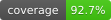

# docgen

[](https://pkg.go.dev/github.com/USA-RedDragon/docgen) [](https://github.com/USA-RedDragon/docgen) [](https://github.com/USA-RedDragon/docgen/actions/workflows/test.yaml) [](https://github.com/USA-RedDragon/docgen/blob/main/LICENSE)

docgen fills the facts in your Markdown docs from your Go code. You write the prose and put a marker where a fact from the code goes. `docgen update` writes the fact into the marker, and `docgen check` fails in CI when a page no longer matches the code.

## Installation

Install the command. The minimum Go version is <!-- docgen:gomod field=go -->`1.27.0`<!-- /docgen:gomod -->.

```sh
go install github.com/USA-RedDragon/docgen@latest
```

- GitHub Action: <!-- docgen:text text="`uses: USA-RedDragon/docgen@{version}`" -->`uses: USA-RedDragon/docgen@v0.1.0`<!-- /docgen:text -->. See [Check the docs in CI](docs/start/03-check-in-ci.md#add-the-github-action).
- pre-commit hook: `id: docgen-check` of the repository `https://github.com/USA-RedDragon/docgen`. See [Use pre-commit](docs/guides/pre-commit.md).

## Getting started

Put a marker in any Markdown page:

```text
The client waits <!-- docgen:const pkg=client name=DefaultTimeout --><!-- /docgen:const --> for a reply.
```

Fill it from the root of the repository:

```sh
docgen update
```

docgen writes the value between the two comments:

```text
The client waits <!-- docgen:const pkg=client name=DefaultTimeout -->`30s`<!-- /docgen:const --> for a reply.
```

Run `docgen check` in CI. It changes nothing, and exits 1 when a page is out of date. For each step, see [Your first page](docs/start/02-first-page.md).

## Features

For the full list, see [Markers](docs/reference/markers.md).

- Constants and `go.mod` lines, inline in a sentence.
- Tables of config structs. The default of each field comes from the code that applies it, not from the doc text.
- Tables of the errors that the doc comments of a type name.
- State tables and SVG diagrams of state machines, recorded from what your tests do.
- Doc comments as Markdown.
- Code excerpts by symbol from Go, YAML and C files, and by marked region or line range from any file.
- The output of Examples and example programs, and the `-h` usage of commands.
- A version or another value from `.docgen.yaml`, in a sentence or a code block.

## Documentation

Read the docs at <https://usa-reddragon.github.io/docgen/>. Each release has its own version of the docs.

- [Get started](docs/start/01-install.md)
- [Markers](docs/reference/markers.md)
- [Command line](docs/reference/command.md)
- [Configuration](docs/reference/configuration.md)
- [Versioning](docs/project/versioning.md)

## Versioning

- A patch release never breaks your pages or your CI.
- A minor release can add markers and flags, and can make a breaking change. See [Versioning](docs/project/versioning.md).
- The minimum Go version only goes up in a minor or major release.
