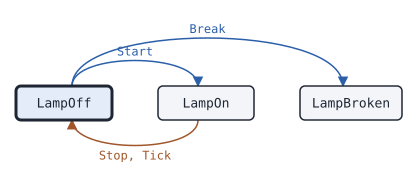
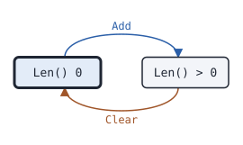
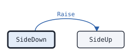

# Lamp

This page covers every marker kind.

<!-- docgen:config pkg=machine type=Config -->
| Field | Type | Default | Description |
|---|---|---|---|
| `Wait` | `time.Duration` | `DefaultWait` (250ms) | Wait is how long the Lamp stays on. 0 means DefaultWait. |
| `Tries` | `int` | `1` | Tries is the number of blinks. 0 means 1, and it is at most MaxTries. |
| `Name` | `string` | zero value | Name is a label. |
<!-- /docgen:config -->

The default wait is <!-- docgen:const pkg=machine name=DefaultWait -->`250ms`<!-- /docgen:const --> and at most <!-- docgen:const pkg=machine name=MaxTries -->`3`<!-- /docgen:const --> tries.

<!-- docgen:states pkg=machine type=Lamp -->
States of [`Lamp`](https://pkg.go.dev/github.com/USA-RedDragon/docgen/v2/machine#Lamp), from [`Lamp.State`](https://pkg.go.dev/github.com/USA-RedDragon/docgen/v2/machine#Lamp.State):

| State | Meaning | Seen in tests |
|---|---|---|
| [`LampOff`](https://pkg.go.dev/github.com/USA-RedDragon/docgen/v2/machine#LampOff) | LampOff gives no light. | yes, first state |
| [`LampOn`](https://pkg.go.dev/github.com/USA-RedDragon/docgen/v2/machine#LampOn) | LampOn gives light. | yes |
| [`LampBroken`](https://pkg.go.dev/github.com/USA-RedDragon/docgen/v2/machine#LampBroken) | LampBroken never gives light again. | yes |

Transitions seen in tests:

| From | Method call | To |
|---|---|---|
| LampOff | `Start` | LampOn |
| LampOff | `Break` | LampBroken |
| LampOn | `Stop`, `Tick` | LampOff |


<!-- /docgen:states -->

<!-- docgen:states pkg=machine type=Counter -->
[`Counter`](https://pkg.go.dev/github.com/USA-RedDragon/docgen/v2/machine#Counter) has no State method. The state in this table is the result of `Len()`. States seen in tests:

| State | Seen in tests |
|---|---|
| Len() 0 | yes, first state |
| Len() > 0 | yes |

Transitions seen in tests:

| From | Method call | To |
|---|---|---|
| Len() 0 | `Add` | Len() > 0 |
| Len() > 0 | `Clear` | Len() 0 |


<!-- /docgen:states -->

<!-- docgen:errors pkg=machine type=Lamp -->
| Error | Returned by | Meaning |
|---|---|---|
| [`docgen.ConfigError`](https://pkg.go.dev/github.com/USA-RedDragon/docgen/v2#ConfigError) | `NewLamp` | ConfigError is the error of a constructor for a field with a value out of range. |
| [`machine.ErrBusy`](https://pkg.go.dev/github.com/USA-RedDragon/docgen/v2/machine#ErrBusy) | `Lamp.Start` | ErrBusy is returned by Start while the Lamp is on. |
| [`machine.ErrOff`](https://pkg.go.dev/github.com/USA-RedDragon/docgen/v2/machine#ErrOff) | `Lamp.Stop` | ErrOff is returned by Stop while the Lamp is off. |
<!-- /docgen:errors -->

<!-- docgen:states pkg=machine type=SideState -->
States of [`Pair`](https://pkg.go.dev/github.com/USA-RedDragon/docgen/v2/machine#Pair), from [`Pair.SideState`](https://pkg.go.dev/github.com/USA-RedDragon/docgen/v2/machine#Pair.SideState) for each `Side`:

| State | Meaning | Seen in tests |
|---|---|---|
| [`SideDown`](https://pkg.go.dev/github.com/USA-RedDragon/docgen/v2/machine#SideDown) | SideDown is down. | yes, first state |
| [`SideUp`](https://pkg.go.dev/github.com/USA-RedDragon/docgen/v2/machine#SideUp) | SideUp is up. | yes |

Transitions seen in tests:

| From | Method call | To |
|---|---|---|
| SideDown | `Raise` | SideUp |


<!-- /docgen:states -->

The period is <!-- docgen:const pkg=machine name=period -->`30ms`<!-- /docgen:const --> and the hold <!-- docgen:const pkg=machine name=hold -->`120ms`<!-- /docgen:const -->.

<!-- docgen:doc pkg=machine section=Rates -->
A Lamp blinks at these rates:

  - slow, every [DefaultWait](https://pkg.go.dev/github.com/USA-RedDragon/docgen/v2/machine#DefaultWait)
  - fast, every period
<!-- /docgen:doc -->

<!-- docgen:doc pkg=machine name=Lamp.Start -->
Start turns the Lamp on. It returns ErrBusy while the Lamp is on.
<!-- /docgen:doc -->

<!-- docgen:code file=v2/machine/machine.go lines=96-102 -->
```go
func (l *Lamp) Stop() error {
	if l.state != LampOn {
		return ErrOff
	}
	l.off()
	return nil
}
```
<!-- /docgen:code -->

<!-- docgen:output test=machine.ExampleLamp -->
```text
true
```
<!-- /docgen:output -->

<!-- docgen:output cmd=v2/examples/hello -->
```text
hello from the fixture
```
<!-- /docgen:output -->

<!-- docgen:code file=v2/machine/example_test.go symbol=ExampleLamp -->
```go
func ExampleLamp() {
	l, _ := machine.NewLamp(machine.Config{})
	_ = l.Start(0)
	fmt.Println(l.State() == machine.LampOn)
}
```
<!-- /docgen:code -->

<!-- docgen:code file=v2/machine/machine.go symbol=Lamp.Tick -->
```go
func (l *Lamp) Tick(now time.Duration) {
	if l.state == LampOn && now >= l.until {
		l.off()
	}
}
```
<!-- /docgen:code -->

<!-- docgen:code file=v2/machine/machine.go symbol=SideState -->
```go
type SideState uint8
```
<!-- /docgen:code -->

<!-- docgen:code file=v2/machine/machine.go symbol=SideB -->
```go
const (
	// SideA is the first side.
	SideA Side = iota + 1
	// SideB is the second side.
	SideB
)
```
<!-- /docgen:code -->

It needs Go <!-- docgen:gomod field=go -->`1.24.0`<!-- /docgen:gomod --> or later.

<!-- docgen:flags cmd=cmd/tool -->
```text
Usage of tool:
  -n int
    	how many lines to print (default 3)
```
<!-- /docgen:flags -->

<!-- docgen:doc pkg=cmd/tool section=Flags -->
It takes one flag.
<!-- /docgen:doc -->

<!-- docgen:code file=v2/examples/hello/main.go -->
```go
// Command hello prints a greeting.
package main

import "fmt"

func main() {
	fmt.Println("hello from the fixture")
}
```
<!-- /docgen:code -->
