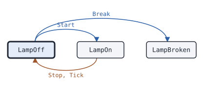

# The lamp

The default wait is <!-- docgen:const pkg=machine name=DefaultWait -->`250ms`<!-- /docgen:const -->.

## Settings

<!-- docgen:config pkg=machine type=Config -->
| Field | Type | Default | Description |
|---|---|---|---|
| `Wait` | `time.Duration` | `DefaultWait` (250ms) | Wait is how long the Lamp stays on. 0 means DefaultWait. |
| `Tries` | `int` | `1` | Tries is the number of blinks. 0 means 1, and it is at most MaxTries. |
| `Name` | `string` | zero value | Name is a label. |
<!-- /docgen:config -->

## Start

<!-- docgen:code file=machine/machine.go symbol=Lamp.Start -->
```go
func (l *Lamp) Start(now time.Duration) error {
	if l.state == LampOn {
		return ErrBusy
	}
	if l.state == LampOff {
		l.state, l.until = LampOn, now+l.wait
	}
	return nil
}
```
<!-- /docgen:code -->

## States

<!-- docgen:states pkg=machine type=Lamp -->
States of [`Lamp`](https://pkg.go.dev/github.com/USA-RedDragon/docgen/v2/machine#Lamp), from [`Lamp.State`](https://pkg.go.dev/github.com/USA-RedDragon/docgen/v2/machine#Lamp.State):

| State | Meaning | Seen in tests |
|---|---|---|
| [`LampOff`](https://pkg.go.dev/github.com/USA-RedDragon/docgen/v2/machine#LampOff) | LampOff gives no light. | yes, first state |
| [`LampOn`](https://pkg.go.dev/github.com/USA-RedDragon/docgen/v2/machine#LampOn) | LampOn gives light. | yes |
| [`LampBroken`](https://pkg.go.dev/github.com/USA-RedDragon/docgen/v2/machine#LampBroken) | LampBroken never gives light again. | yes |

Transitions seen in tests:

| From | Method call | To |
|---|---|---|
| LampOff | `Start` | LampOn |
| LampOff | `Break` | LampBroken |
| LampOn | `Stop`, `Tick` | LampOff |


<!-- /docgen:states -->

## Module

The first line of `go.mod`:

<!-- docgen:output exec="head -n 1 go.mod" -->
```text
module github.com/USA-RedDragon/docgen/v2
```
<!-- /docgen:output -->

The module path, from a pipeline:

<!-- docgen:output exec="cat go.mod | grep module | cut -d' ' -f2" -->
```text
github.com/USA-RedDragon/docgen/v2
```
<!-- /docgen:output -->

## Command

<!-- docgen:usage cmd=cmd/lamp -->
```text
usage: lamp [-wait duration] [-tries n]
  -tries int
    	the number of blinks, at most 3 (default 1)
  -wait duration
    	how long the lamp stays on (default 250ms)
```
<!-- /docgen:usage -->
